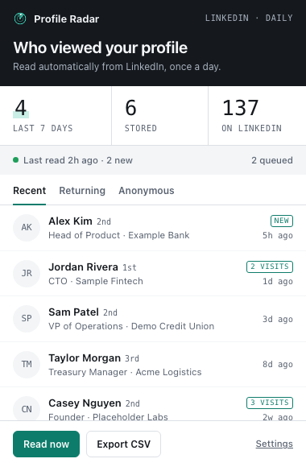
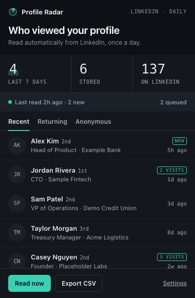

# Profile Radar

A small Chrome extension (Manifest V3) that keeps a log of who viewed your LinkedIn profile. Once a day it reads your own "Who viewed your profile" page inside your own logged-in browser, stores the viewers locally, and shows them in a popup. You can export them as CSV or, optionally, send new viewers to an HTTPS endpoint of your choice.

Profile Radar is an independent project. It is not affiliated with, endorsed by or sponsored by LinkedIn.

<p>
  
  
</p>

*Screenshots use the built-in fictitious demo data.*

## Important: LinkedIn's terms

Automated reading of LinkedIn pages, including your own, goes against the [LinkedIn User Agreement](https://www.linkedin.com/legal/user-agreement), which prohibits using software, scripts, bots, crawlers, browser plugins or add-ons to scrape or otherwise automatically access the service. The extension keeps its footprint small (your real browser, IP and session, one read a day, no clicks), but the risk of a warning or restriction on your account is not zero. **You run it at your own risk, on your own account.** If that is not acceptable to you, do not install it.

## What it does

- Once a day, at a random time inside a window you choose (09:00 to 18:00 by default), it opens `linkedin.com/analytics/profile-views` in a background tab, reads the first batch of viewers and closes the tab. It prefers a moment when LinkedIn is already open in the browser; if nobody opens LinkedIn within 3 hours of the planned time, it reads anyway.
- Right after installation it runs a first, full read on its own (the backfill): it opens the page in the foreground and scrolls to the end of the period. It tries at most once a day, up to 3 days.
- Whenever **you** open the page yourself, it passively reads whatever you load, without scrolling.
- If a daily read finds that every viewer in the first batch is new (10 or more), some people may have been missed, so it runs a foreground catch-up read right away. The popup also warns about it.
- It detects revisits: someone who shows up again as recent when their previous visit was more than 5 days earlier.
- It shows the number of new viewers on the toolbar badge until you open the popup.
- **Read now** in the popup runs a full read on demand. **Export CSV** downloads everything stored.

## What it does not do

- It never clicks, likes, follows, sends messages or connection requests, and never visits anyone's profile.
- It never reads or stores passwords or cookies.
- It does not send analytics or telemetry, and makes no requests to third parties. The only network traffic it creates is the LinkedIn page it opens and, if you configure one, the POST to your endpoint.
- It cannot show what LinkedIn does not show you. On a free account LinkedIn lists only the few most recent viewers. People browsing in private mode are never visible to anyone; semi-private viewers appear only as a description such as "Someone at Example Corp".

## Privacy

Everything stays in your browser, in `chrome.storage.local`, unless you configure an endpoint. Nothing is sent anywhere by default. If you set an endpoint, new viewers (and revisits) are posted to that URL only, with the bearer token you provide. Removing the extension deletes its stored data.

The extension stores, per viewer: name, headline, connection degree, profile URL, profile photo URL, mutual connections text, the relative-time text shown by LinkedIn, approximate visit timestamps, and when the extension first and last saw that person.

## Install

The extension is not published on the Chrome Web Store. Load it unpacked:

1. Download or clone this repository into a folder you will keep (Chrome loads it from there).
2. Open `chrome://extensions` and turn on **Developer mode**.
3. Click **Load unpacked** and select the repository folder (the one with `manifest.json`).
4. Pin the Profile Radar icon to the toolbar.
5. Make sure you are logged in to LinkedIn. About a minute after installation the first read opens the viewers page in a new tab, scrolls it and closes it. You can also click **Read now** in the popup.

To update, pull the new code and click the reload button on the extension card in `chrome://extensions`.

## Configuration

Open **Settings** from the popup (or the extension's options page):

| Setting | Default | Meaning |
| --- | --- | --- |
| Read once a day, automatically | on | Turns the daily read and the first backfill on or off. Passive reading when you open the page yourself always works. |
| Whose profile is this | empty | Optional name shown in the popup subtitle. |
| From / Until (hour) | 9 / 18 | Local-time window in which the daily read starts. The exact minute is random. |
| HTTPS endpoint | empty | Optional URL that receives new viewers. On save, Chrome asks for permission to reach that origin. |
| Bearer token | empty | Optional. Sent as `Authorization: Bearer <token>`. |

**Send pending now** in Settings flushes the queue immediately instead of waiting for the next retry.

## Webhook contract

When an endpoint is set, new viewers and revisits are queued and sent as:

```http
POST <endpoint>
Content-Type: application/json
Authorization: Bearer <token>        (only when a token is set)
```

```json
{
  "source": "linkedin_profile_views",
  "extension_version": "0.4.0",
  "total_period": 137,
  "viewers": [
    {
      "key": "in:example-slug",
      "kind": "identified",
      "slug": "example-slug",
      "name": "Alex Kim",
      "headline": "Head of Product at Example Bank",
      "degree": "2nd",
      "mutual": "12 mutual connections",
      "viewed_text": "Viewed 22h ago",
      "visits": ["2026-01-15T18:00:00.000Z"]
    },
    {
      "key": "anon:someone at example corp",
      "kind": "anonymous",
      "slug": null,
      "name": null,
      "headline": "Someone at Example Corp",
      "degree": null,
      "mutual": null,
      "viewed_text": "Viewed 2d ago",
      "visits": ["2026-01-14T09:00:00.000Z"]
    }
  ]
}
```

- `key` is stable per viewer: `in:<slug>` for identified viewers, `anon:<description>` for anonymous ones. Use it to de-duplicate.
- `total_period` is the total view count LinkedIn shows for the current period, or `null` if it was not found.
- `visits` holds every known visit of that viewer as ISO 8601 timestamps. They are approximate: LinkedIn only shows relative times ("1w ago").
- Text fields are truncated (`key` 400 characters, `name` and `headline` 300, the rest 120).
- Each request carries at most **400 visits**; the rest goes in the next request, sent right after a successful one.
- Any **2xx** response removes the sent viewers from the queue. Anything else (non-2xx, network error) keeps them queued, and the extension retries **every 20 minutes**.
- Without an endpoint the queue simply accumulates locally; if you configure an endpoint later, the backlog is sent.

## Demo mode

Open `popup/popup.html` directly in the browser (as a `file://` URL, outside the extension). Without extension APIs the popup renders fictitious sample data in English, which is handy when working on the layout. All names and companies in the demo are made up.

## Files

| Path | Role |
| --- | --- |
| `manifest.json` | Manifest V3 definition. |
| `background.js` | Service worker: schedule, backfill, catch-up, merge, revisit detection, badge, outbox and webhook. |
| `content.js` | Runs on the viewers page. Passive, daily and full modes. |
| `lib/extract.js` | DOM reader. It does not rely on CSS classes: it finds each card by its relative-time line ("Viewed 3d ago", "Visualizou há 3 d") and walks up to the card. English and Portuguese. |
| `lib/i18n.js` | Small wrapper around `chrome.i18n`, with an English fallback for demo mode. |
| `lib/messages-en.js` | Generated copy of the English strings used by that fallback. |
| `_locales/` | UI strings: `en` (default) and `pt_BR`. |
| `popup/` | Popup UI and shared styles (`ui.css`, light and dark themes). |
| `options/` | Settings page. |
| `img/` | Icons. |
| `scripts/` | `sync-i18n-fallback.mjs` regenerates `lib/messages-en.js`; `make_icons.py` redraws the icons (Pillow). |
| `test/` | Node tests that run without a browser. |
| `docs/` | Screenshots with demo data. |

## Known limitations

- **The LinkedIn DOM can change at any time.** The reader avoids CSS class names on purpose, but a new page structure or new wording for the time line can break it. When that happens the popup shows "List did not load".
- **Scrolling in a hidden tab may not load more than the first page.** LinkedIn loads viewers in batches as you scroll, and a background tab may not trigger the next batch. That is why the daily read counts only on the first batch, and why it runs a foreground catch-up when the whole first batch was new.
- Visit times are approximate, derived from relative text such as "2w ago".
- Only English and Portuguese page wording is recognized.
- Free accounts see only the few most recent viewers, and private-mode viewers are never visible.
- A forced logout, a checkpoint or a captcha stops the read; the popup shows the error and the next attempt happens the following day.

## Development

There is no build step. Edit the files and reload the extension in `chrome://extensions`.

```sh
npm test                       # or: node --test test/   (Node 18+)
node scripts/sync-i18n-fallback.mjs   # after changing _locales/en/messages.json
python3 scripts/make_icons.py         # after changing the icon
```

## Contributing

Issues and pull requests are welcome. Please:

- Keep the extension read-only. Changes that click, message, visit profiles or otherwise act on LinkedIn will not be accepted.
- Keep it free of third-party requests, analytics, remote code and web fonts.
- Add every UI string to both `_locales/en/messages.json` and `_locales/pt_BR/messages.json`, then run the sync script. New languages are welcome as new `_locales/<code>/messages.json` files; the page reader may also need the new wording for "Viewed 3d ago" in `lib/extract.js`.
- When the reader breaks because LinkedIn changed its page, include the relevant (anonymized) HTML structure in the issue or pull request, never real people's data.
- Run `npm test` before opening a pull request.

## License

[MIT](LICENSE)
